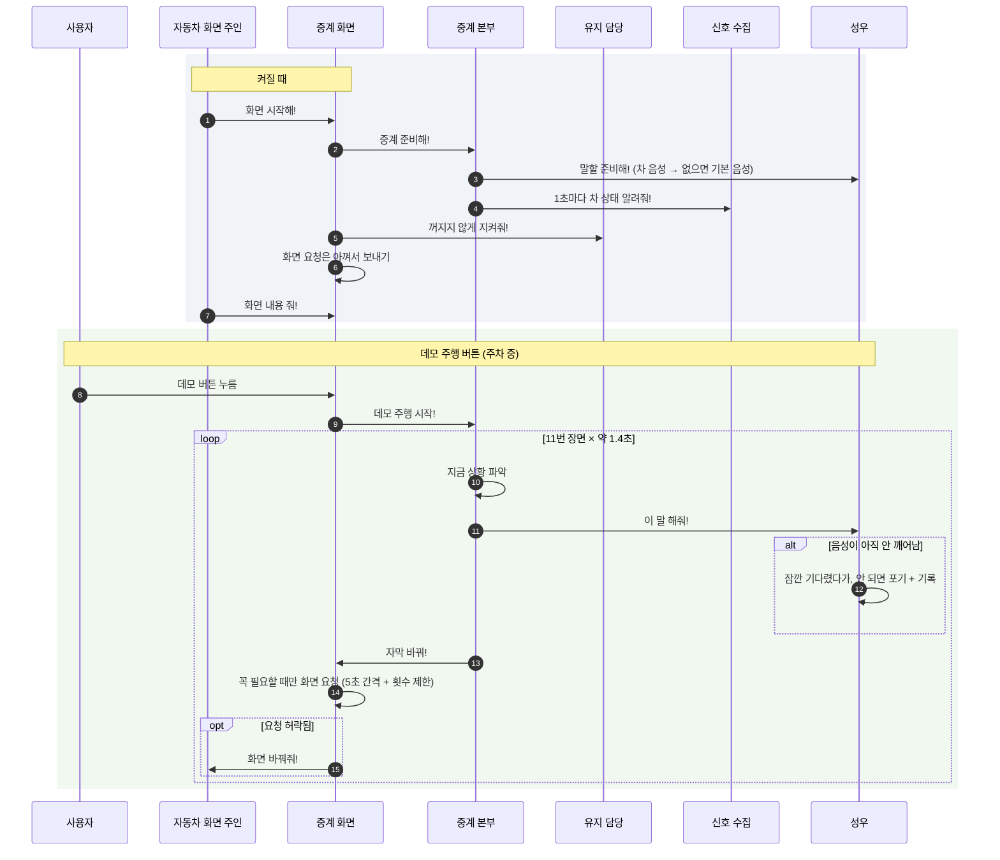
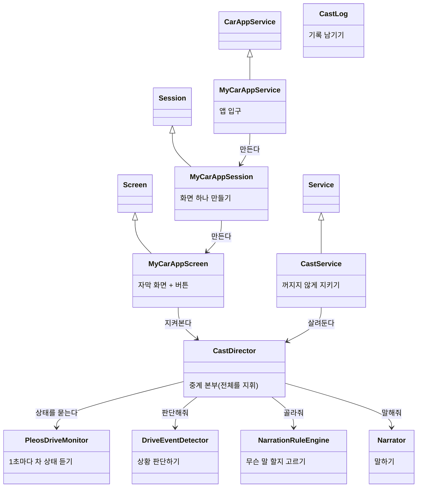

# PleosApp — Live Drive Cast (운전 생중계)

이 앱은 운전을 스포츠 중계처럼 말로 설명해 주는 앱입니다.
자동차 화면(Pleos Connect 헤드유닛)에서 동작합니다.

차가 출발하면 "초록불! 출발합니다!",
급하게 차선을 바꾸면 "어머! 갑자기 차선을 바꾸네요!" 같이
말이 나오고, 화면에는 자막도 함께 뜹니다.

> 개발자용 코드 수준 설명(순서도·구조도)은 [docs/ARCHITECTURE.md](docs/ARCHITECTURE.md)를 보세요.

## 구성 요소

| 이름         | 하는 일                                              |
|--------------|------------------------------------------------------|
| `shared`     | 앱의 실제 기능 전부 (화면, 중계, 음성, 테스트)       |
| `automotive` | 자동차용 설치 버전                                    |
| `mobile`     | 휴대폰용 설치 버전                                    |

## 실행 방법

1. Pleos Connect 에뮬레이터(가상 자동차 화면)를 켜고 `automotive`를 실행합니다.
2. 속도·위치 권한을 물으면 허용합니다.
3. **주차된 상태**에서 "Demo lap(데모 주행)" 버튼을 누릅니다.
   출발 → 급차선 변경 → "진정하세요" 경고 순서로 중계가 나옵니다.
4. 내비게이션 길안내를 시작하면 화면은 내비게이션이 차지하지만,
   음성과 알림으로는 중계가 계속됩니다. 알림에서 멈출 수 있습니다.

## 동작 원리 (쉽게 설명)

이 앱은 **중계 방송국**이라고 생각하면 쉽습니다.

- **귀**: 차의 속도, 방향, 내비 정보를 1초마다 듣습니다.
- **머리**: 들은 것을 보고 "지금 뭐라고 말해야 하지?"를 정합니다.
  (예: 속도가 갑자기 오르면 "출발합니다!")
- **입**: 정한 말을 음성으로 말하고, 화면 자막과 알림에도 보여줍니다.

화면은 앱이 직접 그리지 않습니다. 자동차 시스템(호스트)이 화면 주인이라서,
앱은 "이 내용을 보여주세요"라고 요청 쪽지만 전달합니다.
그래서 화면 갱신 요청을 너무 자주 보내면 주인이 화를 냅니다(뒤에서 설명).





## 대사 규칙 파일: narration_rules.xml

이 파일(`shared/src/main/res/raw/narration_rules.xml`)이 중계의 "대본집"이자
"두뇌"입니다. 무슨 상황에서 무슨 말을 할지가 전부 여기 들어 있어서,
멘트를 바꾸려면 코틀린 코드를 손댈 필요가 없고 이 파일만 고치면 됩니다
(바꾼 뒤에는 재빌드가 필요합니다).

### 구조

파일은 `<narration-rules>` 안에 `<rule>`이 위에서 아래로 나열된 모양이고,
각 규칙 안에 실제 대사 `<line>`이 한 줄 이상 들어 있습니다.

| 항목 | 뜻 |
|------|----|
| `id` | 규칙 이름 (한 번 말하고 쉬는 시간, 대사 돌려쓰기 기준) |
| `event` | 어떤 운전 상황에서 말할지 (아래 9가지 중 하나) |
| `minSpeedKmh` / `maxSpeedKmh` | 이 속도 사이일 때만 말함 (없으면 속도 무관) |
| `minRepeatCount` | 60초 안에 격한 움직임이 이 횟수 이상일 때만 말함 |
| `cooldownMs` | 한 번 말하고 나서 이 시간만큼 조용히 있음 (기본 8000 = 8초) |
| `severity` | 말투: `FUN`(신남 🎙️), `INFO`(차분함 📻), `WARNING`(경고 ⚠️) |

빠진 항목은 기본값이 들어갑니다: 속도 제한 없음, 반복 조건 없음,
쿨다운 8초, 말투 차분함. 대사가 한 줄도 없는 규칙은 무시됩니다.

### 고르는 방법 (위에서부터 첫 번째만)

차가 움직일 때마다 앱은 규칙을 위에서 아래로 훑으며, 조건이 맞는 **첫 번째
규칙 하나**만 말합니다. 그래서 중요한 규칙(경고)이 위에, 일반적인 규칙이
아래에 있습니다. 한 규칙이 말하면 쿨다운 동안은 조용하고, 대사가 여러 줄이면
돌아가면서 말해서 매번 조금씩 다르게 들립니다.

각 `event`가 언제 생기는지 (판정 기준):

| 이벤트 | 생기는 때 |
|--------|-----------|
| `TRIP_START` | 속도가 5 km/h를 넘으면 (출발, 한 번만) |
| `RAPID_ACCEL` | 3초 안에 20 km/h 이상 빨라지면 |
| `SUDDEN_LANE_CHANGE` | 시속 30 km 이상에서 3초 안에 방향이 25° 이상 꺾이면 |
| `REPEATED_SHARP_MOVES` | 위 급조작이 60초 안에 3번 쌓이면 |
| `HARD_BRAKE` | 2초 안에 25 km/h 이상 느려지면 |
| `SPEEDING` | 100 km/h 이상이 되면 (95 아래로 내려가야 해제) |
| `NAV_TURN_AHEAD` | 300 m 안에 회전이 있으면 |
| `NAV_ARRIVING` | 목적지 도착하면 |
| `SMOOTH_CRUISE` | 시속 40~90으로 20초 동안 안정적이면 |

### 지금 들어 있는 9개 규칙 (파일 순서대로)

| 순서 | 이름 | 상황 + 조건 | 말투 | 대사 수 | 예시 대사 |
|------|------|-------------|------|---------|-----------|
| 1 | `too_much` | 격한 움직임 3회 | 경고 | 2 | "Whoa, that's one sharp move too many! Let's calm down, champ." |
| 2 | `trip_start` | 출발 | 신남 | 2 | "And we're GREEN GREEN GREEN! The drive is underway!" |
| 3 | `sharp_lane_change` | 급차선 변경, 시속 30 이상 | 신남 | 3 | "OH! A sudden lane change! What a MOVE!" |
| 4 | `hard_brake` | 급제동 | 경고 | 2 | "Ouch! That was a HARD brake! Keep a safe distance, driver!" |
| 5 | `speeding` | 시속 100 이상 | 경고 | 2 | "Speeding past the limit! Even race cars respect the pit lane speed!" |
| 6 | `rapid_accel` | 급가속 | 신남 | 2 | "And they're OFF! What a launch off the line!" |
| 7 | `nav_turn_ahead` | 전방 회전 | 차분함 | 2 | "Heads up, a turn is coming up ahead. Set yourself up nicely." |
| 8 | `smooth_cruise` | 시속 40~90 안정 주행 | 차분함 | 2 | "A masterclass in calm driving. The commentators can finally relax." |
| 9 | `arriving` | 목적지 도착 | 신남 | 1 | "And across the line! What a finish! Welcome to your destination!" |

콩트 순서가 중요한 예: 데모 주행을 누르면 출발 → 급가속 → 급차선 변경 →
"진정하세요" 경고 → 급제동 → 과속 → 전방 회전 → 도착 순서로 말합니다.
파일이 없거나 비어 있으면 앱에 내장된 예비 2개 규칙(급차선 변경, 진정
경고)으로 중계가 이어지므로, 대사가 완전히 멈추지는 않습니다.

### 고치고 싶으면

- 대사 바꾸기: 해당 `<line>` 글자만 고치세요.
- 말 안 나오게 하기: 규칙을 지우거나 쿨다운(`cooldownMs`)을 크게 하세요.
- 순서 바꾸기: `<rule>` 블록째로 잘라서 위·아래로 옮기세요. 위에 있을수록
  먼저 말할 기회를 잡습니다.

## 쓰는 Pleos API (자세히)

이 앱이 쓰는 Pleos SDK는 4개입니다. 공통 규칙이 하나 있습니다: 전부
**리플렉션 + 실패 무시(`runCatching`)** 로 묶습니다. 그래서 Pleos 서비스가
없는 일반 에뮬레이터에서도 앱이 죽지 않고, 없는 신호는 그냥 기본값으로
둡니다. 진짜 헤드유닛에서는 클라이언트 라이브러리가 붙어 실제 SDK가
켜집니다.

| 용도 | SDK (버전) | 쓰는 것 |
|------|-----------|---------|
| 차량 상태(문) | Vehicle 2.3.2 | `Vehicle`, `initialize()`, `getDoor()`, `Door.getCurrentDoorPosition(구역, 성공콜백, 실패콜백)`, `release()` |
| 내비 상태 | NaviHelper 3.0.5 | `NaviHelper`, `initialize()`, `addListener()`, `NaviHelperEventListener`(아래 표), `removeListener()`, `release()` |
| 움직임 | FusedLocation 1.1.3 | `FusedLocation`, `isSupported()`, `initialize()`, `registerFusedLocationCallback(리스너의 onChanged/onError)`, 등록 해제, `release()` |
| 음성 | TextToSpeech 3.3.1 | `TextToSpeech(앱, Mode)`, `initialize()`, `addEventListener(리스너)`, `speak(문장)`, `stop()`, `release()` |
| 속도 | AAOS 기본 속성 (Pleos 아님) | `Car.createCar`, `getCarManager("property")`, 속도 콜백 등록 |

버전은 `PLEOS_SDK_NOTES.md`와 같고, 실제 클라이언트 라이브러리는 이
의존성으로 묶습니다:

```gradle
implementation "ai.pleos.playground:Vehicle:2.3.2"
implementation "ai.pleos.playground:NaviHelper:3.0.5"
implementation "ai.pleos.playground:TextToSpeech:3.3.1"
implementation "ai.pleos.playground:FusedLocation:1.1.3"
```

### 1. 차량 상태 — Vehicle (문 열림 확인용)

- 쓰는 순서: `Vehicle(앱)` 만들기 → `initialize()` → `getDoor()`로 문
  객체 가져오기 → `getCurrentDoorPosition(구역, 성공할 때, 실패할 때)` 호출
  → 끝난 뒤 `release()`.
- 구역은 `DoorArea` + `DoorValue.ROW_1_LEFT`(앞좌석 문)로 지정합니다.
- 결과 숫자가 0이면 "문 닫힘", 아니면 "문 열림"으로 기록해 자막에
  "🚪 문 열림!"을 띄웁니다.
- 없으면 로그에 `pleos vehicle unavailable`이 남고 문 상태는 모름으로 둡니다.

### 2. 내비 상태 — NaviHelper (길안내 중인지, 도착했는지)

- 쓰는 순서: `NaviHelper(앱)` 만들기 → `initialize()` →
  `addListener(리스너)` → 안 쓰면 `removeListener()`, `release()`.
- 리스너가 받는 신호와 앱의 반응:

| 오는 신호 | 앱이 이해하는 것 |
|-----------|------------------|
| `onRouteStarted`, `onRoutingCompleted`, `onReRouteEnded`, `onDestinationChanged`, `onWaypointChanged` | 길안내 중 |
| `onRouteCancelled` | 길안내 끝 (리셋) |
| `onDestinationArrived`, `onWayPointArrived` | 목적지 도착 |
| `onBoardInfo`, `onRouteOptionChanged` | 무시 |

- 없으면 로그에 `navihelper unavailable, nav status idle`이 남고,
  "📍 내비 휴식 중" 상태로 둡니다.

### 3. 움직임 — FusedLocation (방향과 속도)

- 쓰는 순서: `FusedLocation(앱)` 만들기 → `isSupported()` 확인 →
  `initialize()` → `registerFusedLocationCallback(리스너)` → 안 쓰면 등록
  해제, `release()`.
- 리스너의 `onChanged`가 올 때마다 위치 데이터에서 방향(`getBearing` 등
  여러 이름으로 시도)과 속도(`getSpeed` 등)를 읽습니다. 속도는 m/s로 오므로
  3.6을 곱해 km/h로 바꿉니다.
- 없으면 로그에 `fused location unavailable, speed-only mode`가 남고,
  아래 4번의 차량 속성 속도로만 움직입니다.

### 4. 속도 — AAOS 차량 속성 (Pleos SDK가 아님)

- `Car.createCar(앱)` → `getCarManager("property")` → 속도 콜백 등록
  (`PERF_VEHICLE_SPEED`, 초당 미터) → m/s 값을 3.6배 해 km/h로 씁니다.
- Pleos Connect가 AAOS 기반이라 이 속성은 헤드유닛에 그대로 있습니다.
- 붙으면 로그에 `speed bound via vehicle property`, 안 붙으면
  `vehicle speed unavailable`이 남습니다.

### 5. 음성 — TextToSpeech (멘트 읽기)

- 쓰는 순서: `TextToSpeech(앱, Mode)` 만들기 → `initialize()` →
  `addEventListener(리스너)` → `speak(문장)` → 안 쓰면 `stop()`, `release()`.
- `Mode.ON_DEVICE`는 인터넷도 가입 승인도 필요 없어서 오프라인으로
  말합니다. `HYBRID`로 바꾸면 서버 음성을 쓰지만 내 프로젝트 등록이
  필요합니다.
- Pleos TTS가 없으면 플랫폼 기본 TTS로 넘어갑니다. 플랫폼 TTS 초기화도
  실패하면 조용히 무한 반복하지 않고, 약 20초 재시도 뒤 대사를 버리고
  로그에 남깁니다 (`TtsRetryTest` 참고).
- 붙으면 로그에 `tts: pleos engine` 또는 `tts: platform engine`이 남습니다.

## 이벤트 판정과 핵심 로직

"언제 무슨 일이 일어났다고 볼 것인가"의 기준은 전부 코드에 숫자로 박혀
있습니다. 핵심 로직은 파일 3개에 들어 있고, 흐름은 이렇습니다.

```
스냅샷(속도·방향·내비·문) → DriveEventDetector.update() → 이벤트 목록
→ NarrationRuleEngine.pick() → 대사 하나 (또는 없음)
```

### 1단계: 스냅샷 만들기 (`PleosDriveMonitor`)

1초마다 지금 상태를 한 장 찍습니다: 시간, 속도, 방향, 문 열림 여부, 내비
상태. 데모 주행 버튼을 누르면 가짜 11장을 1.4초 간격으로 직접 만들어
넣습니다 (아래 데모 순서 참고).

### 2단계: 이벤트 판정 (`DriveEventDetector.update()`)

스냅샷을 전 장과 비교해 아래 기준에 맞으면 이벤트를 붙입니다.
숫자는 전부 `DriveEventDetector` 맨 위 기본값입니다.

| 이벤트 | 판정 기준 |
|--------|-----------|
| `TRIP_START` | 속도가 5 km/h를 넘으면 (출발, 한 번만) |
| `RAPID_ACCEL` | 3초 안에 20 km/h 이상 빨라지면 |
| `SUDDEN_LANE_CHANGE` | 시속 30 km 이상에서 3초 안에 방향이 25° 이상 꺾이면 (방향 차이는 360°가 이어지도록 계산) |
| `REPEATED_SHARP_MOVES` | 위 급조작이 60초 안에 3번 쌓이면 |
| `HARD_BRAKE` | 2초 안에 25 km/h 이상 느려지면 |
| `SPEEDING` | 100 km/h 이상이 되면 시작, 95 아래로 내려가야 끝 |
| `NAV_TURN_AHEAD` | 300 m 안에 회전이 있으면 |
| `NAV_ARRIVING` | 목적지 도착 표시가 오면 (한 번만, 도착 취소되면 리셋) |
| `SMOOTH_CRUISE` | 시속 40~90 사이에서 앞뒤 속도 차가 3 이내로 20초 유지되면 |

방향은 그대로 두면 한 방향으로 계속 쌓이므로, 60초 지난 기록은 버리고
`repeatedSharpCount`를 다시 셉니다. 속도가 조금씩 올라도 급가속이 아니고,
잠깐 느려졌다가도 과속 해제가 바로 안 되는 식으로, 경계에서 멘트가
깜빡이지 않게 여유를 두었습니다.

### 3단계: 대사 고르기 (`NarrationRuleEngine.pick()`)

순서는 이렇고, 하나라도 어긋나면 다음 규칙으로 넘어갑니다:

1. 이번에 온 이벤트가 없으면 바로 끝 (말하지 않음).
2. 규칙을 파일 순서대로 봅니다.
3. 규칙의 이벤트가 이번 이벤트 안에 있어야 합니다.
4. 속도가 규칙의 속도 구간 안이어야 합니다.
5. 격한 움직임 횟수가 규칙의 최소 횟수 이상이어야 합니다.
6. 이 규칙이 쿨다운(마지막으로 말한 지 정해진 시간) 안에 말했으면 건너뜁니다.
7. 다 맞은 첫 번째 규칙의 대사를 돌려쓰기 순서대로 하나 골라 말합니다.
   (같은 규칙 안에서 매번 다음 줄이 나와서 반복 청취가 덜 지겹습니다.)

고른 대사는 `Narration(문장, 말투, 규칙이름)` 하나로 묶여 화면 자막과
음성에 같이 쓰이고, 로그에는
`call [심각도/규칙이름]: 문장` 형태로 남습니다.

### 화면 글자와 말투 꾸미기 (`CastDirector`)

- 말투 표시: 신남은 🎙️, 차분함은 📻, 경고는 ⚠️ 를 문장 앞에 붙입니다.
- 상태 줄은 항상 새로 만듭니다:
  `🚗 몇 km/h • 🧭 몇 ° • 📍 내비 상태 • (문 열리면 🚪 문 열림!)`
- 음소거 중이면 새 멘트가 와도 자막 제목은 🔇 로 바뀌고 말은 하지 않습니다.
  대신 `speak suppressed (muted)` 로그가 남습니다.

### 데모 주행 대본 (`CastDirector.runDemo()`)

데모 버튼은 11장짜리 정해진 주행을 1.4초 간격으로 흘려보냅니다.
숫자는 (속도, 방향)이며, 마지막 두 장에는 내비 정보가 붙습니다:

```
정지(0, 90°) → 출발(22, 90°) → 가속(60, 90°) → 급차선(62, 122°) →
연속(61, 155°) → 3번째(63, 188°) → 유지(64, 188°) → 급제동(34, 188°) →
과속(105, 188°) → 회전 approaching(55, 188°, 250 m 앞) → 도착(20, 185°)
```

그래서 실제 로그에는 출발 → 급가속 → 급차선 변경 → "진정하세요" 경고 →
급제동 → 과속 → 전방 회전 → 도착 순서로 `call [...]` 줄이 찍힙니다.

### 파일 위치 정리

- 판정 숫자 전부: `shared/.../drive/DriveEventDetector.kt` 맨 위
- 고르는 순서 전부: `shared/.../narration/NarrationRules.kt`의 `pick()`
- 엮는 순서 전부: `shared/.../cast/CastDirector.kt`의 `onSnapshot()`
- 대본 글자 전부: `shared/src/main/res/raw/narration_rules.xml`

## 주요 파일 위치

| 파일 | 하는 일 |
|------|---------|
| `shared/src/main/java/com/ys/pleosapp/shared/MyCarAppService.kt` | 앱 입구 |
| `shared/src/main/java/com/ys/pleosapp/shared/MyCarAppSession.kt` | 화면 하나 만들기 |
| `shared/src/main/java/com/ys/pleosapp/shared/MyCarAppScreen.kt` | 자막 화면, 버튼, 화면 요청 조절 |
| `shared/src/main/java/com/ys/pleosapp/shared/CastActions.kt` | 버튼은 최대 2개, 화면 요청 규칙 |
| `shared/src/main/java/com/ys/pleosapp/shared/cast/CastDirector.kt` | 중계 본부 |
| `shared/src/main/java/com/ys/pleosapp/shared/cast/CastService.kt` | 꺼지지 않게 지키기 + 알림 |
| `shared/src/main/java/com/ys/pleosapp/shared/pleos/PleosDriveMonitor.kt` | 차 상태 듣기 |
| `shared/src/main/java/com/ys/pleosapp/shared/pleos/Narrator.kt` | 말하기 (차 음성 → 기본 음성) |
| `shared/src/main/java/com/ys/pleosapp/shared/drive/DriveEventDetector.kt` | 상황 판단하기 |
| `shared/src/main/java/com/ys/pleosapp/shared/narration/NarrationRules.kt` | 무슨 말 할지 고르기 |
| `shared/src/main/java/com/ys/pleosapp/shared/util/CastLog.kt` | 기록 남기기 |

## 지금 안 되는 것들

- **가상 화면(에뮬레이터)에서는 소리가 안 납니다.** 말하는 기능 자체가
  가상에 없어서 그렇습니다. 실제 자동차에서는 될 것으로 보고, 말하는
  부분은 그대로 두었습니다.
- **주차 화면 글자는 가끔 건너뜁니다.** 화면 주인이 "화면은 5번까지만
  바꿔줘"라고 정해 둬서, 글자는 아껴서 바꿉니다. 말과 알림은 전부 나옵니다.
- **가상 화면에서는 속도만 압니다.** 위치·내비·문 상태는 실제 차에서만
  들어옵니다.
- **데모 주행은 주차 중에만 됩니다.** 움직이는 차에서는 버튼이 안 먹습니다.

## 앞으로 할 일

1. **진짜 차에서 확인하기**: 소리가 나는지, 차 정보가 들어오는지.
2. **오래 켜 두기 테스트**: 오래 틀어놔도 화면 주인이 화내지 않는지.
3. **목소리 없을 때 화면에 표시하기**: 지금은 기록에만 남는데, 화면에도
   "목소리 준비 안 됨" 같은 안내를 보여주는 것을 검토 중입니다.
4. **멘트 다듬기**: `narration_rules.xml`의 대사와 타이밍 조정.

6. **맞춤 광고 (나중).** 운전 습관이나 자주 가는 길에 맞는 광고(예: 자주 지나치는 길의 카페 쿠폰)를 음성·알림으로 전하는 것을 검토합니다. 운전 방해가 되지 않게 음소거·횟수 제한을 두고, 운전자 동의가 전제입니다.

## 문제가 생기면

개발자에게 다음 3가지를 알려주세요. 원인을 찾는 데 그대로 쓰입니다.

1. 무엇을 눌렀는지 (예: 데모 주행 버튼)
2. 화면에 무엇이 보였는지 (예: 자막이 멈춤, 앱이 꺼짐)
3. 소리가 났는지 안 났는지
