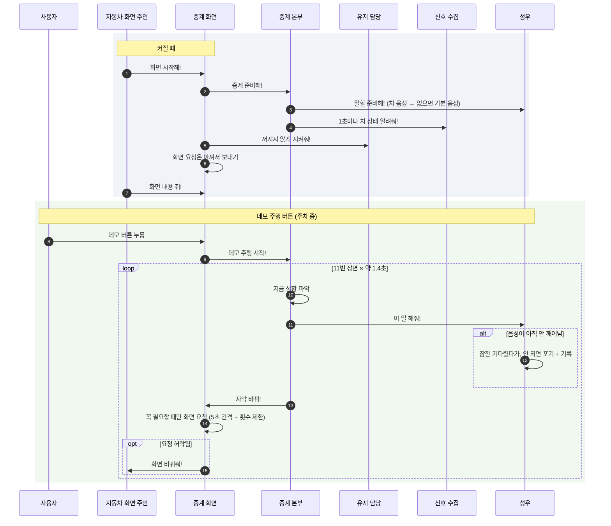
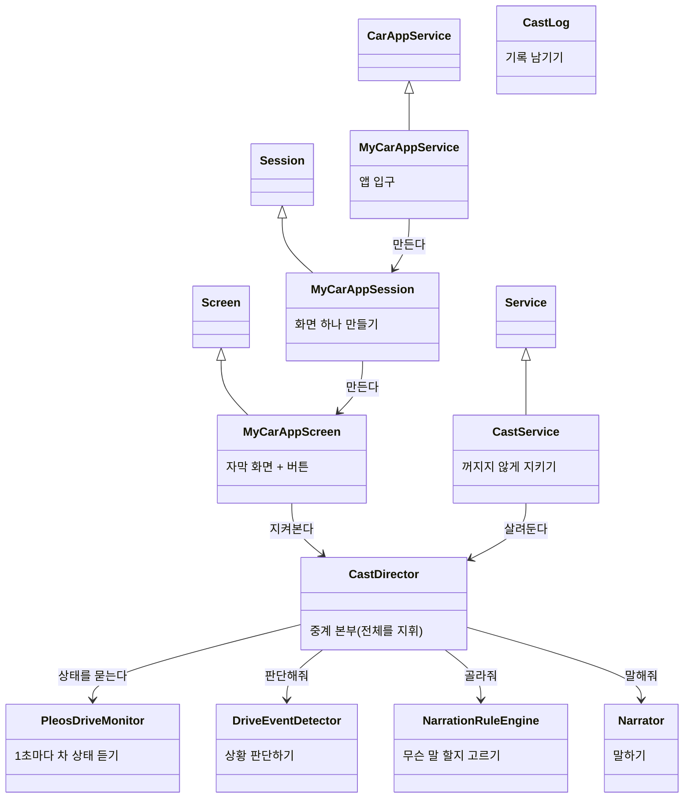

# PleosApp — Live Drive Cast (운전 생중계)

이 앱은 운전을 스포츠 중계처럼 말로 설명해 주는 앱입니다.
자동차 화면(Pleos Connect 헤드유닛)에서 동작합니다.

차가 출발하면 "초록불! 출발합니다!",
급하게 차선을 바꾸면 "어머! 갑자기 차선을 바꾸네요!" 같이
말이 나오고, 화면에는 자막도 함께 뜹니다.

> 개발자용 코드 수준 설명(순서도·구조도)은 [docs/ARCHITECTURE.md](docs/ARCHITECTURE.md)를 보세요.

## 구성 요소

| 이름         | 하는 일                                              |
|--------------|------------------------------------------------------|
| `shared`     | 앱의 실제 기능 전부 (화면, 중계, 음성, 테스트)       |
| `automotive` | 자동차용 설치 버전                                    |
| `mobile`     | 휴대폰용 설치 버전                                    |

## 실행 방법

1. Pleos Connect 에뮬레이터(가상 자동차 화면)를 켜고 `automotive`를 실행합니다.
2. 속도·위치 권한을 물으면 허용합니다.
3. **주차된 상태**에서 "Demo lap(데모 주행)" 버튼을 누릅니다.
   출발 → 급차선 변경 → "진정하세요" 경고 순서로 중계가 나옵니다.
4. 내비게이션 길안내를 시작하면 화면은 내비게이션이 차지하지만,
   음성과 알림으로는 중계가 계속됩니다. 알림에서 멈출 수 있습니다.

## 동작 원리 (쉽게 설명)

이 앱은 **중계 방송국**이라고 생각하면 쉽습니다.

- **귀**: 차의 속도, 방향, 내비 정보를 1초마다 듣습니다.
- **머리**: 들은 것을 보고 "지금 뭐라고 말해야 하지?"를 정합니다.
  (예: 속도가 갑자기 오르면 "출발합니다!")
- **입**: 정한 말을 음성으로 말하고, 화면 자막과 알림에도 보여줍니다.

화면은 앱이 직접 그리지 않습니다. 자동차 시스템(호스트)이 화면 주인이라서,
앱은 "이 내용을 보여주세요"라고 요청 쪽지만 전달합니다.
그래서 화면 갱신 요청을 너무 자주 보내면 주인이 화를 냅니다(뒤에서 설명).

## 주요 파일 위치

| 파일 | 하는 일 |
|------|---------|
| `shared/src/main/java/com/ys/pleosapp/shared/MyCarAppService.kt` | 앱 입구 |
| `shared/src/main/java/com/ys/pleosapp/shared/MyCarAppSession.kt` | 화면 하나 만들기 |
| `shared/src/main/java/com/ys/pleosapp/shared/MyCarAppScreen.kt` | 자막 화면, 버튼, 화면 요청 조절 |
| `shared/src/main/java/com/ys/pleosapp/shared/CastActions.kt` | 버튼은 최대 2개, 화면 요청 규칙 |
| `shared/src/main/java/com/ys/pleosapp/shared/cast/CastDirector.kt` | 중계 본부 |
| `shared/src/main/java/com/ys/pleosapp/shared/cast/CastService.kt` | 꺼지지 않게 지키기 + 알림 |
| `shared/src/main/java/com/ys/pleosapp/shared/pleos/PleosDriveMonitor.kt` | 차 상태 듣기 |
| `shared/src/main/java/com/ys/pleosapp/shared/pleos/Narrator.kt` | 말하기 (차 음성 → 기본 음성) |
| `shared/src/main/java/com/ys/pleosapp/shared/drive/DriveEventDetector.kt` | 상황 판단하기 |
| `shared/src/main/java/com/ys/pleosapp/shared/narration/NarrationRules.kt` | 무슨 말 할지 고르기 |
| `shared/src/main/java/com/ys/pleosapp/shared/util/CastLog.kt` | 기록 남기기 |

## 지금 안 되는 것들

- **가상 화면(에뮬레이터)에서는 소리가 안 납니다.** 말하는 기능 자체가
  가상에 없어서 그렇습니다. 실제 자동차에서는 될 것으로 보고, 말하는
  부분은 그대로 두었습니다.
- **주차 화면 글자는 가끔 건너뜁니다.** 화면 주인이 "화면은 5번까지만
  바꿔줘"라고 정해 둬서, 글자는 아껴서 바꿉니다. 말과 알림은 전부 나옵니다.
- **가상 화면에서는 속도만 압니다.** 위치·내비·문 상태는 실제 차에서만
  들어옵니다.
- **데모 주행은 주차 중에만 됩니다.** 움직이는 차에서는 버튼이 안 먹습니다.

## 앞으로 할 일

1. **진짜 차에서 확인하기**: 소리가 나는지, 차 정보가 들어오는지.
2. **오래 켜 두기 테스트**: 오래 틀어놔도 화면 주인이 화내지 않는지.
3. **목소리 없을 때 화면에 표시하기**: 지금은 기록에만 남는데, 화면에도
   "목소리 준비 안 됨" 같은 안내를 보여주는 것을 검토 중입니다.
4. **멘트 다듬기**: `narration_rules.xml`의 대사와 타이밍 조정.

## 문제가 생기면

개발자에게 다음 3가지를 알려주세요. 원인을 찾는 데 그대로 쓰입니다.

1. 무엇을 눌렀는지 (예: 데모 주행 버튼)
2. 화면에 무엇이 보였는지 (예: 자막이 멈춤, 앱이 꺼짐)
3. 소리가 났는지 안 났는지
