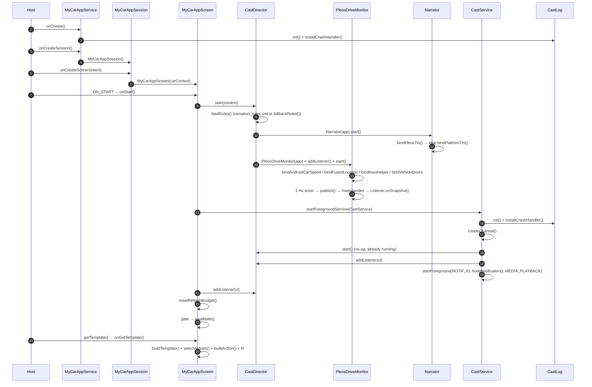
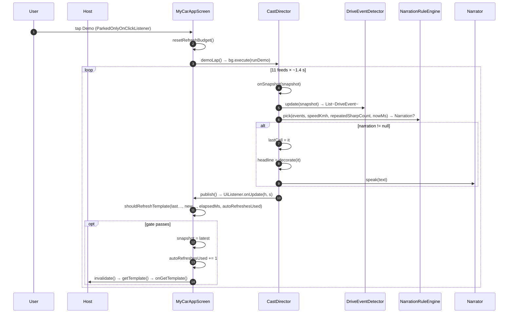
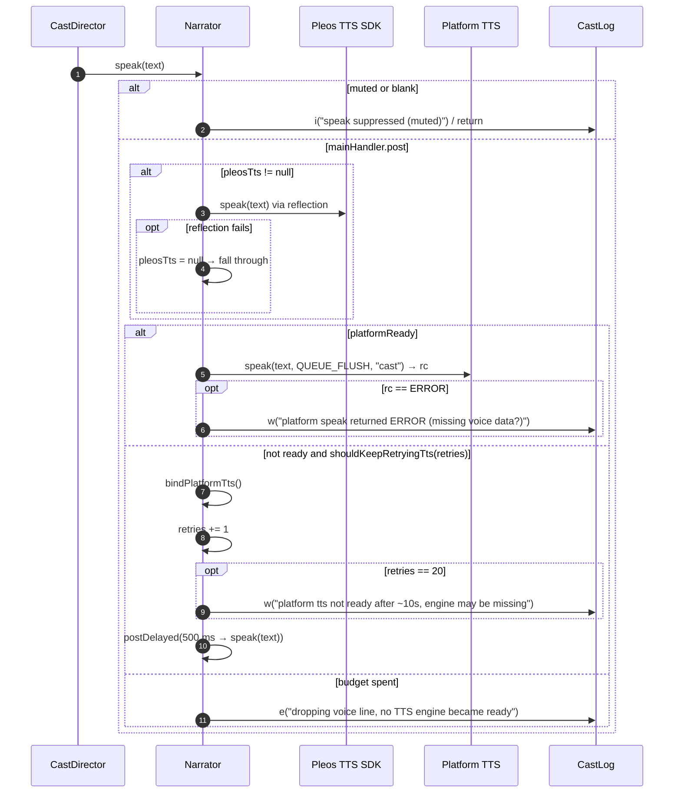
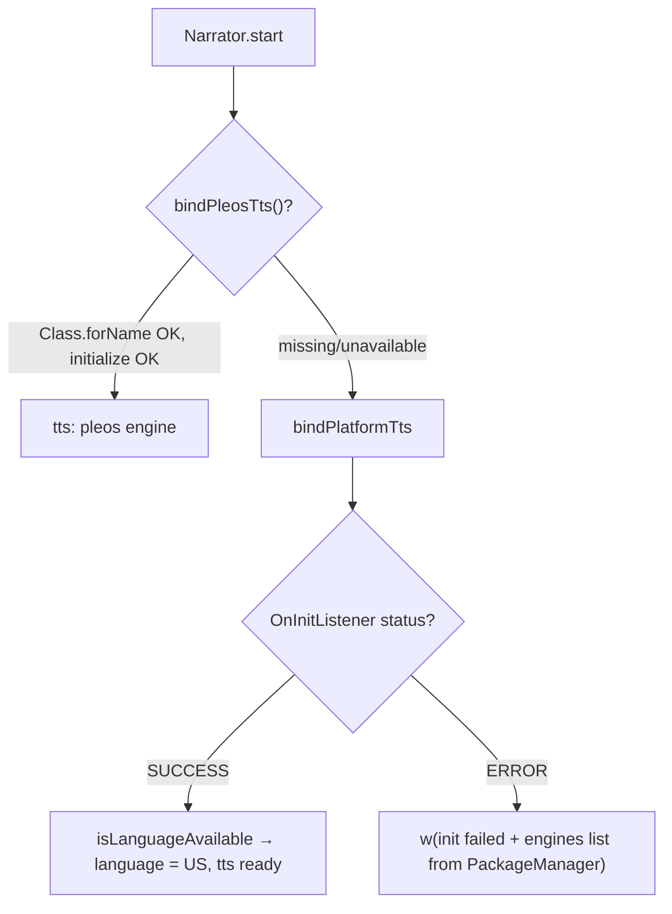

# Live Drive Cast — code-level flows (developer doc)

Companion to [README.md](../README.md). Class names, method names, and call
order below match the sources under `shared/src/main/java`. Mermaid blocks
render on GitHub / IDE preview.

## 1. Startup and wiring

How the car host, the screen, the director, the monitor, and the keep-alive
service connect. `CastDirector.start()` is `synchronized` and idempotent:
every entry point calls it, only the first call binds anything.

Notes:

- `PleosDriveMonitor.publish()` runs on the ticker thread and re-posts to
  `mainHandler`; `DriveEventDetector` / `NarrationRuleEngine` are only
  touched on `CastDirector`'s single `bg` executor.
- First render is free: `shouldRefreshTemplate()` returns true when the
  last-rendered snapshot is null.

## 2. Demo lap commentary loop

One tap drives 11 scripted snapshots through the real pipeline. Voice and
the notification fire on every call; the template only refreshes when the
gate allows (changed content, ≥ 5 s since last refresh, ≤ 3 auto-refreshes
per host flow).

## 3. Narrator speak / TTS fallback chain

`Narrator.speak()` never throws and never blocks a caller thread: everything
runs on `mainHandler`. When no engine is ready it retries every 500 ms up to
`TTS_NOT_READY_MAX_RETRIES` (40 ≈ 20 s), then drops the line with an error
log. `muted` short-circuits before any of this.

`start()` binding order, for reference:

